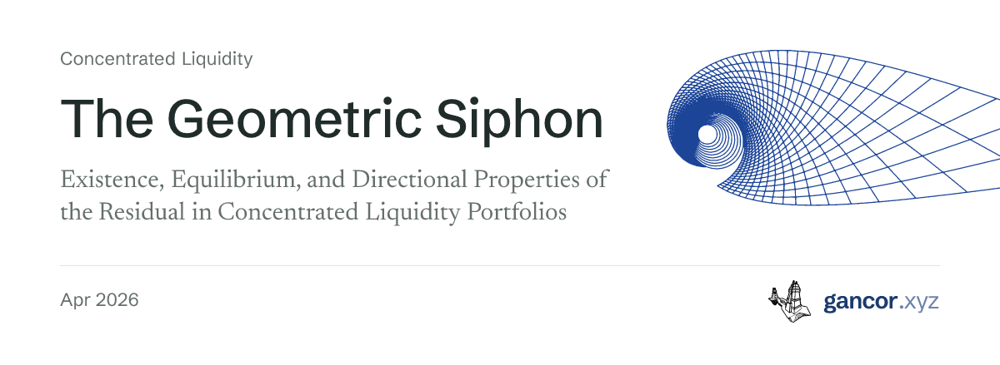

<p align="center">
  <picture>
    <source media="(prefers-color-scheme: dark)" srcset=".github/banner-dark.png" />
    <source media="(prefers-color-scheme: light)" srcset=".github/banner-light.png" />
    
  </picture>
</p>

# The Geometric Siphon

[](https://github.com/g4nc0r/the-geometric-siphon/actions/workflows/lean.yml)
[](https://github.com/g4nc0r/the-geometric-siphon/actions/workflows/foundry.yml)
[](https://doi.org/10.2139/ssrn.6686798)
[](https://doi.org/10.5281/zenodo.19526374)
[](https://doi.org/10.5281/zenodo.19904831)


Paper sources, Lean formalisation, Foundry verification suite and reproduction scripts for *The Geometric Siphon: Existence, Equilibrium, and Directional Properties of the Residual in Concentrated Liquidity Portfolios* (K. R. Ryan, 2026).

When a concentrated liquidity position is moved to a new range, the old and new ranges generally require different token ratios at the current price, and the mint leaves part of one token behind. This is the geometric residual. Where rebalanced positions share one token balance, what the internal swap does not absorb passes through that balance to other positions. Six theorems characterise the residual and its long-run behaviour, and six propositions follow it through the swap and into the shared balance, one of which gives an accounting rule that removes the transfer.

## Where to start

| If you want to | Go to |
|---|---|
| Read the paper | [`papers/the-geometric-siphon.pdf`](./papers/the-geometric-siphon.pdf), or [SSRN 6686798](https://doi.org/10.2139/ssrn.6686798) |
| Check the proofs | [`lean/`](./lean/), 92 machine-checked statements |
| Check the arithmetic against a live pool | [`foundry/`](./foundry/), 16 tests, 6 on a Base fork |
| Run the simulator | [`simulator/`](./simulator/), standard library only |
| Reproduce the tables | [`reproduction/`](./reproduction/) with the [data deposit](https://doi.org/10.5281/zenodo.19904831) |

## What is checked where

| Result | Paper | Lean | Foundry, mock pool | Foundry, Base fork |
|---|---|---|---|---|
| Theorem 1, geometric residual | §3.2 | [`GeometricResidual`](./lean/GeometricSiphon/GeometricResidual.lean), [`ResidualShare`](./lean/GeometricSiphon/ResidualShare.lean) | 3 tests | 3 tests |
| Theorem 2, single-pool convergence | §3.4 | [`ConvergenceDiscrete`](./lean/GeometricSiphon/ConvergenceDiscrete.lean), in a declared discrete model | not applicable | not applicable |
| Theorem 3, zero-swap extinction | §3.6 | [`Extinction`](./lean/GeometricSiphon/Extinction.lean), parts (i), (iii), (iv) | 4 tests | |
| Theorem 4, residual monotonicity | §3.7 | [`Monotonicity`](./lean/GeometricSiphon/Monotonicity.lean), [`MonotonicityDown`](./lean/GeometricSiphon/MonotonicityDown.lean) | 1 test | |
| Theorem 5, directional asymmetry | §3.8 | [`DirectionalExit`](./lean/GeometricSiphon/DirectionalExit.lean) | 1 test | 1 test |
| Theorem 6, exit asymmetry | §3.9 | [`DirectionalExit`](./lean/GeometricSiphon/DirectionalExit.lean) | 1 test | 1 test |
| Proposition 7, partial-swap extinction | §3.10 | [`PartialSwap`](./lean/GeometricSiphon/PartialSwap.lean) | | |
| Proposition 8, swap leftover | §3.10 | not formalised (first order) | | |
| Proposition 9, displacement identity | §3.11 | [`ResidualShare`](./lean/GeometricSiphon/ResidualShare.lean) | | |
| Proposition 10, retained excursion | §3.11 | [`Excursion`](./lean/GeometricSiphon/Excursion.lean) | | |
| Proposition 11, netting | §3.12 | [`SharedBalance`](./lean/GeometricSiphon/SharedBalance.lean) | | |
| Proposition 12, neutral accounting | §3.12 | [`SharedBalance`](./lean/GeometricSiphon/SharedBalance.lean) | | |
| Architectural precondition | §7.1 | | | 1 test |

The Lean proofs are in real arithmetic. The Foundry suite is the check against fixed-point pool arithmetic. What each Lean file covers, and what it leaves out, is listed in [`lean/README.md`](./lean/README.md).

## Papers

| Version | Where | Status |
|---|---|---|
| The Geometric Siphon (consolidated) | [`papers/`](./papers/), [SSRN 6686798](https://papers.ssrn.com/sol3/papers.cfm?abstract_id=6686798) | Live preprint, revised November 2026 |
| Paper I: Emergent Capital Reallocation in Concentrated Liquidity Portfolios | [`papers/archive/paper-i/`](./papers/archive/paper-i/), [SSRN 6374838](https://papers.ssrn.com/sol3/papers.cfm?abstract_id=6374838) | Superseded by the consolidated paper |
| Paper II: Directional Properties | [`papers/archive/paper-ii/`](./papers/archive/paper-ii/), [SSRN 6481498](https://papers.ssrn.com/sol3/papers.cfm?abstract_id=6481498) | Superseded by the consolidated paper |

The November 2026 revision corrects several empirical statements of the May version against on-chain events. Appendix F of the paper lists each one with its old and new value. The May version is kept in [`papers/archive/`](./papers/archive/).

## Quick start

```bash
# Lean: build and audit (first run fetches prebuilt mathlib, several GB)
cd lean
lake exe cache get && lake build
lake env lean AxiomCheck.lean

# Foundry: 10 mock-pool tests, no network
cd foundry
git submodule update --init --recursive
forge test --no-match-contract '(GeometricResidualProof|DirectionalExitForkProof)$'

# Foundry: all 16 tests, 6 against Aerodrome Slipstream on a Base fork
RPC_BASE_ALCHEMY=https://mainnet.base.org forge test

# Tables: from inside the unpacked data deposit
cd reproduction
python3 run_all.py
```

## Layout

```
.
├── papers/             current paper (.pdf, .tex), with a README
│   └── archive/          May 2026 version, Paper I, Paper II
├── lean/               Lean 4 formalisation
│   ├── GeometricSiphon/  shared definitions and twelve result files
│   ├── AxiomCheck.lean   axiom audit, 92 statements
│   └── README.md         coverage by paper result, and scope
├── foundry/            Foundry verification suite
│   ├── src/              MockCLPool.sol, MockCLPoolV2.sol
│   ├── test/             5 test contracts, helpers, interfaces
│   ├── PROOF_OUTPUT.md   captured forge output, mapped to paper sections
│   └── README.md
├── simulator/          exact integer simulator: reference implementation and example
├── reproduction/       Python scripts that regenerate the paper's tables
├── CITATION.cff
├── LICENSE
└── README.md
```

## Lean formalisation

[`lean/`](./lean/) holds machine-checked proofs of Theorems 1 to 6, Propositions 7 and 9 to 12, and their corollaries, in Lean 4 against mathlib. Theorem 2 is proved in a discrete model of the rebalance process that the file declares. Propositions 11 and 12 are proved as statements about an accounting rule. Proposition 8 is a first-order statement and is not formalised. The axiom audit covers 92 statements, each depending only on `propext`, `Classical.choice` and `Quot.sound`.

## Foundry verification suite

[`foundry/`](./foundry/) holds 16 tests across 5 contracts, covering Theorems 1 and 3 to 6 and the architectural precondition of §7.1. Ten run on mock pools with no network access. Six run against the unmodified Aerodrome Slipstream contracts on a Base fork pinned to block `43_175_000` (10 March 2026, 10:42 UTC), so the captured residuals are reproducible. Any Base RPC with archive support works in `RPC_BASE_ALCHEMY`. The captured output and the test-to-section mapping are in [`foundry/PROOF_OUTPUT.md`](./foundry/PROOF_OUTPUT.md).

## Reproducing the tables

[`reproduction/`](./reproduction/) holds twelve Python scripts, standard library only, that compute the tables resting on the event logs of the data deposit. The logs are not in this repository. Download the deposit from <https://doi.org/10.5281/zenodo.19904831> and place `reproduction/` inside it. Which tables are reproduced exactly, and where the output differs from the printed table, is listed in [`reproduction/README.md`](./reproduction/README.md).

## Simulator

[`simulator/`](./simulator/) holds the reference implementation of the exact simulator of §6, an example, and the check of Proposition 10 in integer arithmetic. The parallel implementation and the parameter-grid experiments of §5.12 to §5.14 are not included.

The on-chain dataset of §4.6 is not published.

## Citation

Cite the consolidated preprint. A `CITATION.cff` with the same metadata is at the repository root.

<details>
<summary>BibTeX</summary>

```bibtex
@techreport{ryan2026siphon,
  author      = {Ryan, K. R.},
  title       = {The Geometric Siphon: Existence, Equilibrium, and Directional
                 Properties of the Residual in Concentrated Liquidity
                 Portfolios},
  institution = {SSRN},
  number      = {6686798},
  year        = {2026},
  doi         = {10.2139/ssrn.6686798},
  url         = {https://papers.ssrn.com/sol3/papers.cfm?abstract_id=6686798}
}

@techreport{ryan2026siphon1,
  author      = {Ryan, K. R.},
  title       = {The Geometric Siphon: Emergent Capital Reallocation in
                 Concentrated Liquidity Portfolios},
  institution = {SSRN},
  number      = {6374838},
  year        = {2026},
  doi         = {10.2139/ssrn.6374838},
  url         = {https://papers.ssrn.com/sol3/papers.cfm?abstract_id=6374838}
}

@techreport{ryan2026siphon2,
  author      = {Ryan, K. R.},
  title       = {The Geometric Siphon II: Directional Properties},
  institution = {SSRN},
  number      = {6481498},
  year        = {2026},
  doi         = {10.2139/ssrn.6481498},
  url         = {https://papers.ssrn.com/sol3/papers.cfm?abstract_id=6481498}
}
```

</details>

## Author and licence

| | |
|---|---|
| **Author** | K. R. Ryan, independent researcher |
| **Contact** | [gancor.xyz](https://gancor.xyz) · ORCID [0009-0004-6295-7040](https://orcid.org/0009-0004-6295-7040) · code and reproduction questions via [GitHub Issues](https://github.com/g4nc0r/the-geometric-siphon/issues) |
| **Licence** | code MIT (`LICENSE`); data deposit CC-BY-4.0; paper PDFs and LaTeX sources © K. R. Ryan, all rights reserved |
